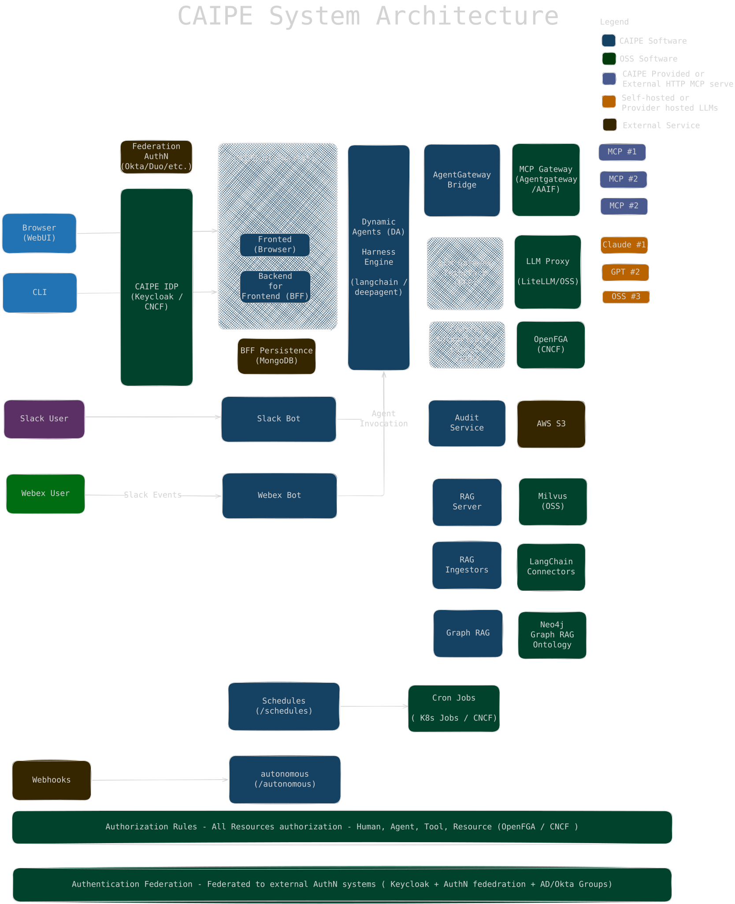
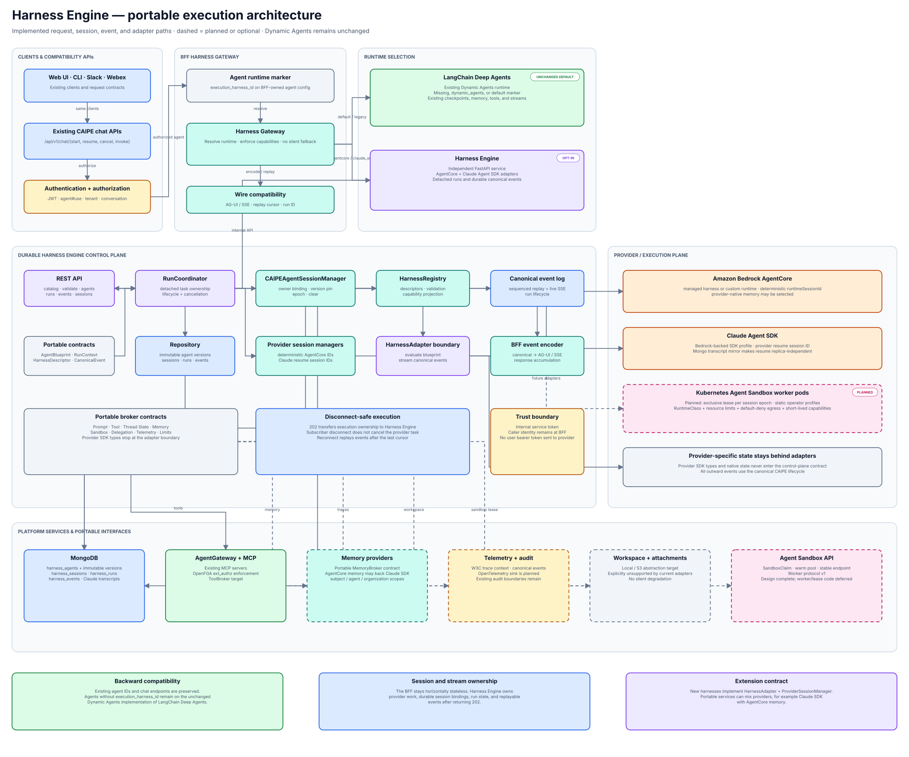
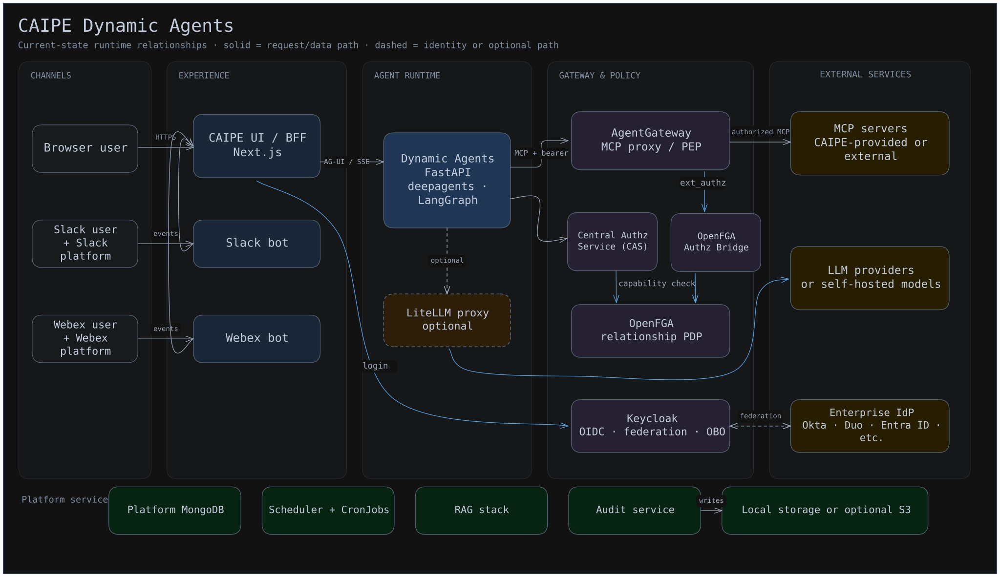
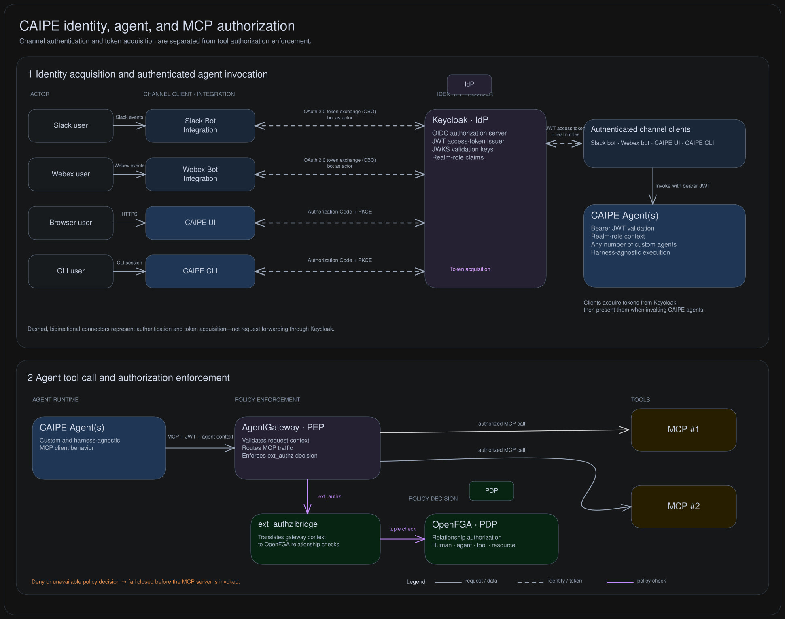
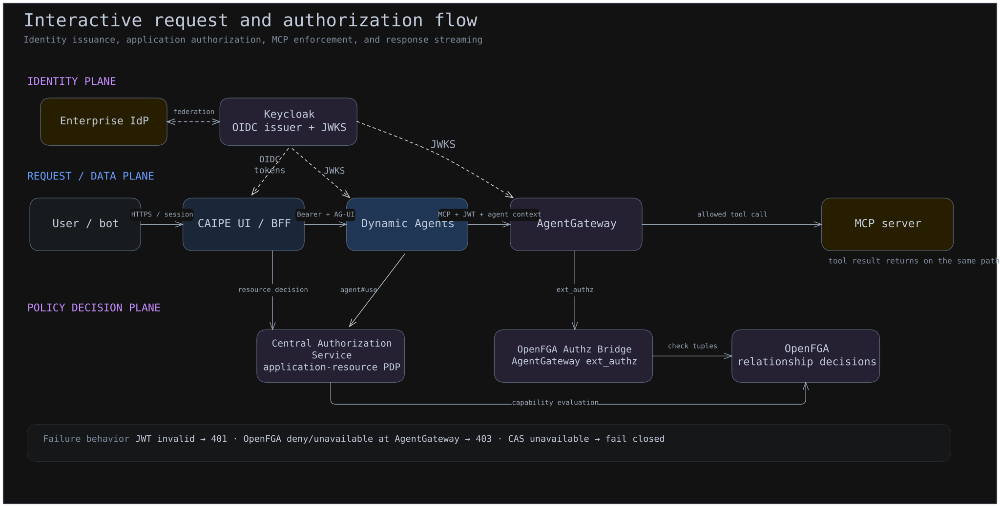
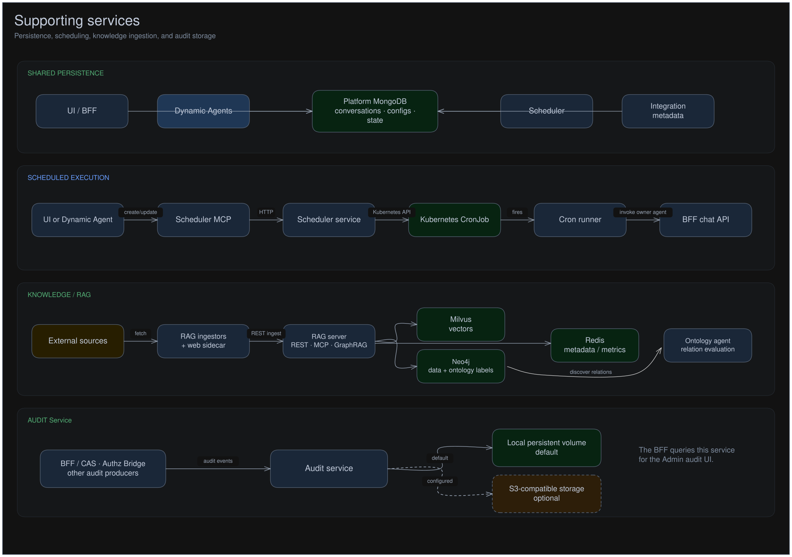

# Solution Architecture

Users reach CAIPE through Slack, Webex, the UI, or CLI. Keycloak authenticates every path, CAIPE Agent(s) run the request, and AgentGateway routes MCP tool calls after OpenFGA authorization.

## CAIPE System Architecture

## Harness Engine

Harness Gateway preserves the existing CAIPE chat APIs while routing each
authorized conversation to its saved execution owner. Native ACP retains the
Dynamic Agents runtime and durable coordinator; SDK/provider selections use
Harness Engine. Each run has one owner and authoritative journal in canonical
CAIPE MongoDB. See [gateway and native ACP execution](native-acp-metaharness.md)
for the combined contract. The foundation diagrams below describe #2401; dashed
paths are interfaces whose runtime capabilities must be qualified separately.

Editable source: [CAIPE system architecture](https://github.com/caipe-io/ai-platform-engineering/blob/main/docs/excalidraw/caipe-system-architecture.excalidraw)

### Source graph

The source graph shows where the compatibility boundary, durable control plane,
provider adapters, deployment configuration, contracts, and regression tests
live in the repository.

Editable source: [Harness Engine source graph](https://github.com/caipe-io/ai-platform-engineering/blob/main/docs/excalidraw/harness-engine-source-graph.excalidraw)

## CAIPE Dynamic Agents

## CAIPE Authorization Flow

### Authz High Level 

### Authz OpenFGA

## CAIPE Supporting Services

