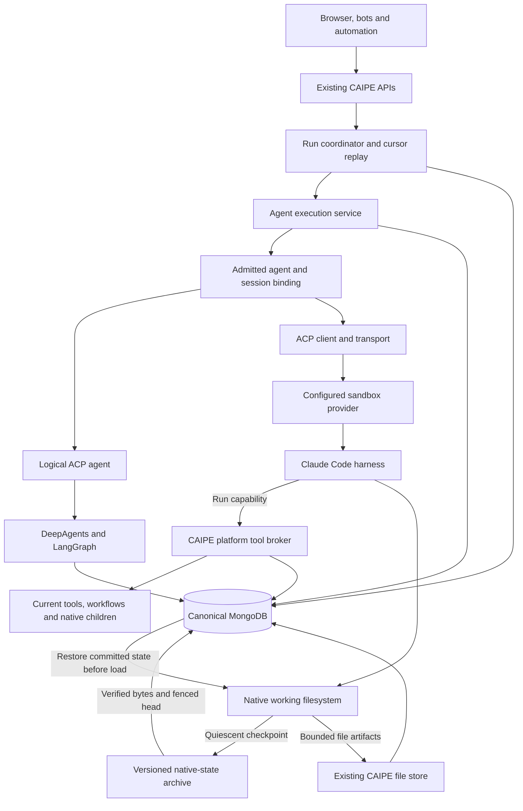
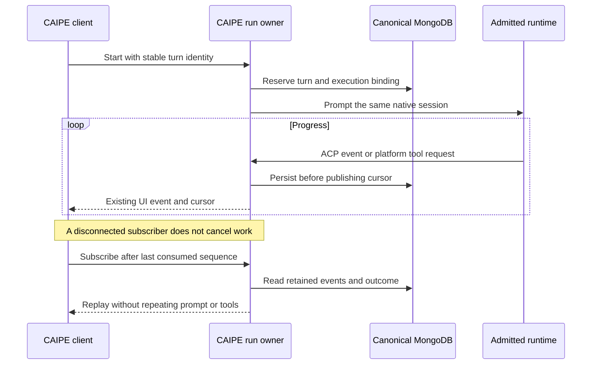
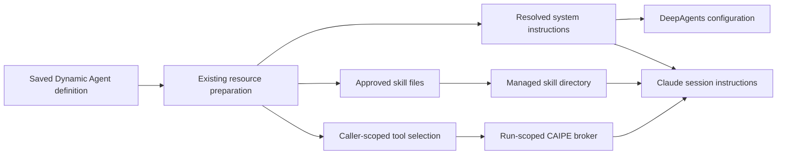

# ACP metaharness

CAIPE owns agent definitions, execution admission, conversation history and the
workflow engine. ACP connects that platform to the runtime executing an agent.
A logical DeepAgents agent and a sandboxed CLI harness use the same CAIPE chat,
run journal and human-input lifecycle; their native state remains different.

The [native ACP foundation #2883](https://github.com/caipe-io/ai-platform-engineering/pull/2883) supplies the common native path and detached execution.
The [sandbox extension #2982](https://github.com/caipe-io/ai-platform-engineering/pull/2982) adds Claude Code profiles,
remote ACP transport, a platform tool/workspace bridge and canonical native-state checkpoints.
This design and source update makes no deployment or SRE runtime change.
**These additions are under review. Remote deployment, provider authentication,
network policy and complete skills qualification remain pending approval.**
This document does not imply that a deployed agent has changed runtimes.

## Execution tiers: one agent definition, explicit workspace boundaries

Keep the current DeepAgents runtime and Dynamic Agents definitions as the compatibility path. New runtime investment targets coding harnesses through ACP, starting with Claude Code, rather than building another SDK agent engine. Harness implementations may internally use an SDK; CAIPE delegates the reasoning loop instead of maintaining another one. Sandbox use is opt-in: an existing agent or conversation never changes runtime because a new profile becomes available. New agents can choose an admitted coding profile in the same editor; there is no second agent product or separate chat experience.

| Tier and name | User experience | Workspace and security boundary | Delivery position |
| --- | --- | --- | --- |
| **1 · Managed Agent** | Existing DeepAgents agent with its saved prompt, tools, skills and logical files. No environment to manage. | Shared service; each conversation retains its own admitted checkpoint/file namespace and caller-scoped tools. A logical filesystem is not an OS sandbox. | Existing runtime retained behind logical ACP. No new SDK engine is introduced. |
| **2 · Team Sandbox** | The existing SDK agent can use one approved sandbox and shared working directory for an agent/team. Users keep separate conversations but intentionally collaborate on the same files. | One explicit trust domain. Workspace membership, not agent visibility alone, grants access to shared files. No per-user directories are presented as a security boundary. | Proposed, not selectable in this phase. Requires a qualified sandbox backend and shared-workspace checkpoint/concurrency semantics. |
| **2.5 · Virtual Coding Harness** | Explore a coding harness restricted to brokered tools and a simulated filesystem, without offering a shell or general local file tools. | Logical isolation only. The harness still needs host runtime files; ACP filesystem callbacks cannot virtualize its built-in tools. | Research option, not an admitted runtime or a claim of full Claude Code parity. |
| **3 · Private Coding Sandbox** | Select an approved Claude Code profile and use ordinary CAIPE chat, tools, approvals and files. Provisioning is automatic. | Shared agent definition; a user-owned conversation gets the whole isolated environment and native session. Another caller or conversation cannot reuse its HOME/workspace. | Implemented in the sandbox PR for review; provider deployment and live policy qualification are still required. |

For tier 3, start with **one sandbox per conversation, owned by its initiating user**. This supplies per-user isolation without adding per-user folders inside a shared sandbox, and separates two unrelated chats from the same user. Reusing one environment across all of a user's conversations is a later optimization, not an implicit property of this implementation. Reuse images, immutable tools and provider worker pools; do not share writable HOME, native sessions or credentials between callers.

For tier 2, prefer **one shared agent/team workspace** over a complicated hierarchy of private user workspaces. Sharing is deliberate: participants may read each other's files and affect later work. Keep private credentials and personal evidence out of that workspace. Model context and canonical transcripts remain conversation-scoped; this does not make shared files private. Start with one mutable run at a time under a workspace lease. Restoring one conversation's whole-environment snapshot would overwrite another user's work, so the current private-sandbox checkpoint contract must not be relabelled as a team sandbox. Team workspace versions, conversation state and deletion need separate ownership rules before admission.

Tier 2.5 is attractive only if it retains useful coding behavior. A tools-only Claude runtime with custom logical-file tools may be feasible, but the [Claude tool configuration](https://code.claude.com/docs/en/agent-sdk/python#claudeagentoptions) distinguishes auto-approval from tool availability: `allowed_tools` is not a tool-removal boundary. Built-in shell/file tools, settings, plugins and unapproved MCP servers would have to be disabled, and all file operations routed through authorized logical storage. Native Git/shell/skills behavior cannot then be assumed to work unchanged. **The recommended new-agent path remains tier 3**, while tier 2.5 is evaluated independently; do not put an unrestricted coding CLI on a shared application host and call its filesystem simulated.

### Agent, user, conversation and workspace are different identities

| Identity | Meaning in every tier |
| --- | --- |
| Agent definition | A shared, versioned configuration: instructions, skills, tool/resource selections and an approved runtime profile. Creating one agent does not create one agent per user. |
| Caller | The independently authenticated principal using CAIPE. Agent-use permission and workflow authorization remain required. Channel names, email addresses and chat-room membership cannot substitute for this identity. |
| Conversation and run | Canonical history plus the admitted native session, turn identity, pending decisions and execution lease. A shared definition does not merge conversations. |
| Workspace | Logical files in tier 1, an explicitly shared team directory in tier 2, or the private conversation environment in tier 3. Its grant and lifecycle are distinct from viewing a transcript. |

The tier 1 catalog describes interactive defaults. Existing server-admitted workflow artifact namespaces remain run-scoped; they do not turn a tier 3 environment into a shared physical workspace.

An authorized viewer of history does not automatically receive shell access, the native session or permission to continue as its owner. Sharing work means an explicit workspace grant or approved artifact export. The existing owner checks and durable session binding remain authoritative; a new UI label is not an authorization control.

## One execution service, admitted runtime placements

The execution service owns leases, binding resolution, runtime lifetime and
state operations. HTTP routes retain authentication, authorization and request
validation. Selecting a sandbox does not create a second conversation writer,
workflow engine or authorization system.

| Protocol boundary | Behavior |
|---|---|
| CAIPE clients | Existing AG-UI/custom SSE and invoke contracts; stable turn IDs and sequenced reconnect. |
| Native ACP | Released Python SDK `0.12.1`, stable wire protocol `1`; acknowledged `caipe.io/native-acp` events preserve existing native progress and checkpointed approvals. |
| External ACP | The same pinned SDK and wire protocol, standard initialization, new/load, prompt, updates, permission requests and cancellation. A saved native session must load successfully; failure never falls back to a fresh conversation. |
| Form elicitation | A narrow validated shim covers newer schema form messages missing from the SDK callback surface. It accepts session-bound supported fields/choices and bounded decisions; URL elicitation and unsupported schemas are rejected. It does not enable the unstable protocol. |
| Transport | One bounded JSON-RPC object per non-TTY WebSocket message. Stderr and lifecycle controls are separate from ACP. Redirects cannot forward the caller's bearer to another destination. |

The [released ACP schema 1.26.0](https://github.com/agentclientprotocol/agent-client-protocol/releases/tag/schema-v1.26.0) is the current coverage reference; stable v1 and unstable methods remain distinct. SDK major versions do not determine the wire version. Additional methods are advertised only after the pinned adapter and CAIPE client qualify them.

Typed events remain the internal boundary. The ACP client renders progress
through existing encoders, including separate reasoning, tools, warnings and
human-input events. It does not infer execution state by parsing UI text.
Native client filesystem/terminal capabilities remain unadvertised; CLI
harnesses operate their own sandbox filesystem and native tools.

The [Harness Engine discussion](https://github.com/orgs/caipe-io/discussions/2405)
and [gateway implementation](https://github.com/caipe-io/ai-platform-engineering/pull/2401)
provide related session, configuration UI and detached-run foundations. This
implementation keeps those concerns behind one CAIPE execution service and ACP
boundary. Provider-specific state is bound to canonical sessions rather than
introducing another routing engine or conversation database.

## Sessions and persistence

| State | Authority and location |
|---|---|
| Conversation and visible history | Existing CAIPE conversation/BFF APIs in canonical MongoDB. The browser remains the interactive transcript writer. |
| Effective configuration and placement | `native_acp_sessions`: original agent/session identity, configuration snapshot and immutable checkpoint/filesystem or sandbox binding. |
| Native runtime state | Existing LangGraph checkpoint collections and logical file namespace. ACP does not rename the original thread. |
| Claude Code runtime state | Opaque versioned HOME/workspace archives in canonical MongoDB GridFS, with manifests in `native_acp_checkpoints`. The provider filesystem is the working copy. |
| Active execution and checkpoint head | `native_acp_runs` owns the native lease, checkpoint publication fence and recovery intent; `native_acp_execution_runs` owns turn identity, producer association, outcome and pending human decisions. |
| Replay | `native_acp_execution_events` stores sequenced output; subscribers do not own or restart execution. |
| Platform tool calls | `native_acp_tool_requests` stores bounded, idempotent requests and results under the owning run/lease. Only the producer holding that lease executes them. |

### Canonical storage without replacing the native harness

Claude Code continues to use its native files while running. CAIPE checkpoints
those files into the same MongoDB database as conversation and execution records;
a provider volume is a working cache rather than the only recoverable copy.
This preserves native transcripts, sub-agent state, compaction, file history,
settings, binary workspace files and local database/WAL files without translating
them into CAIPE chat messages. It does not require an experimental external
session-store API or change the harness's native file checkpointing.

| Boundary | Guarantee |
|---|---|
| Successful turn | CAIPE closes and drains the ACP process, validates the complete archive and persisted hash, then publishes the checkpoint head under the existing live lease before emitting success. A storage failure cannot become a successful completed turn. |
| Next turn | Restore the committed head before native `session/load`, including on a healthy volume. Uncommitted working files cannot silently replace canonical state. Each hydration uses a new restore identity. |
| Lost allocation | A committed checkpoint permits owner-bound replacement, verified restore and lease-fenced allocation rebinding. Caller, profile/runtime versions and native session ID stay pinned. No checkpoint means no fabricated recovery. |
| Stop or graceful failure | Attempt a bounded quiescent checkpoint while the same worker still owns the lease. If capture fails, retain the previous committed head and report the failure. |
| First prompt | Keep the new live native session open until its first settled prompt can be checkpointed. Before that first checkpoint, the journal is durable but total working-storage loss can lose unfinished native state. |
| Hard worker loss | Retain canonical output and the last committed native checkpoint; report interruption. Do not repeat prompts, tools or approval callbacks to reconstruct a response. |
| Upgrade | Require the admitted profile and native adapter/SDK versions. Format or runtime changes need a qualified migration; a matching visible transcript is insufficient. |

The checkpoint is an opaque, bounded archive, not a second conversation service.
Uploads remain unpublished until fully validated. The checkpoint head shares the
existing lease document so an expired worker cannot overwrite a newer owner's
state. Replacement recovery records its intent before provisioning, then makes
the destination executable only after the verified restore receipt and fenced
binding update. Interrupted restores block execution until recovery completes.

Archives include the managed workspace manifest so revoked skills and inputs can
be removed correctly. Fixed exclusions omit runtime locks, checkpoint scratch
files and known native login credential files. Credentials are supplied again by
the deployment. Workspace content can still contain secrets produced by tools;
apply the same access, encryption and backup controls as other sensitive CAIPE
records. Active snapshots retain three recent recovery versions plus restore
provenance. Turn boundaries also pin the native states needed to edit retained
conversation history, so their storage grows with that history;
clear/delete removes live checkpoint records and blobs, with bounded orphan
cleanup for interrupted uploads. Backup expiry remains an operator policy.

The initial archive contract allows 256 MiB of archive and expanded state,
128 MiB per file and 20,000 entries. Oversized or inconsistent native state
fails checkpointing explicitly. Capacity planning must include the whole working
HOME, including repository metadata and native session history, rather than only
the text artifacts displayed in CAIPE.

Admission acquires the native lease before reading or changing runtime state.
The 120-second lease is extended with one-second heartbeat/cancellation polling;
workers require synchronized clocks. New turns refresh permitted configuration
while retaining admitted storage and placement. Human-input resume uses its
saved configuration narrowed by current grants.

A sandbox binding additionally pins the original caller, configured connection,
profile revision, namespace, environment UID, cwd and provider session ID.
Changing a profile/image/policy or failing native session load requires explicit
migration or a new conversation. Losing an environment can recover the same
native session from its committed checkpoint under the pinned profile. Existing native checkpoints
are not imported into a different harness as if they were that harness's state.

Worker loss retains persisted output and the last committed native state but
reports interruption.
Neither the lease nor the journal provides exactly-once effects at an external
service. A claimed platform tool request is not reclaimed after uncertain
failure. Recovery must never repeat a prompt or mutation merely to reconstruct
its response.

## Platform tools, children and human input

The sandbox receives a random run capability for one configured CAIPE MCP
endpoint. Caller bearers and connected-provider credentials remain in the
producer's server-side tool closures. Any API replica may authenticate the
capability and queue a call; only the admitted producer executes it.

- Tool discovery reuses native resource preparation. Each call rechecks current
  agent use, tool configuration and resource admission; a configuration change
  can narrow a running session rather than redirect its pinned workspace.
- Native built-ins, selected MCP/remote tools, workflow tools and configured
  skills retain their existing service owners. The workflow engine is unchanged.
- A configured native child receives its own canonical execution context and
  lease. Delegation rechecks the reference, agent use and evidence boundary,
  including after human pauses; a child cannot reuse its parent's run capability
  or introduce a second sandbox through an unqualified nested execution path.
- Native child/tool approvals, ACP permission requests and supported forms use
  the existing CAIPE UI. The durable pending request validates the actual
  displayed options/schema; model-authored values cannot become human approval.
- Reply submission is idempotent and resumes the waiting producer. It does not
  launch another prompt. Explicit cancellation resolves pending callbacks and
  stops the admitted execution; closing a browser or tool HTTP observer does not.

ACP capability negotiation is not an authorization grant. Existing CAIPE caller,
conversation, workflow and tool authorization still applies. Restricted evidence
and storage aliases must pass execution/workspace admission before they can
cross into an external runtime.

## Workspace and filesystem policy

Native DeepAgents keeps its simulated filesystem. Real CLI execution requires
a separate environment with persistent storage and enforced filesystem/network
policy. ACP itself supplies neither isolation nor egress enforcement.

| Workspace operation | Contract and limit |
|---|---|
| Prepare instructions/skills | One managed snapshot containing `AGENTS.md`, `CLAUDE.md`, `.agents/skills/<id>/...` or `.claude/skills/<id>/...`; the profile selects the harness. |
| Seed workflow files | Permission-checked canonical text and binary files become `inputs/<safe relative path>` in the same prepare call. Shared workflow namespaces require the current canonical run/step/owner; arbitrary namespace overrides are rejected. |
| Prepare bounds | At most 128 files, 1 MiB total and 256 KiB per file. The persistent workspace lock prevents preparation during an active ACP process; stale managed files are removed. |
| Read/list | Bounded regular files, excluding private metadata, credentials, symlinks, hardlinks and special files. Provider listing is bounded at 1,000 results/4,096 visited entries; content at 512 KiB. |
| Publish artifacts | Copy bounded text and binary artifacts into the existing canonical file namespace; do not publish instructions, skills, inputs, credentials or native provider state. Export limits/warnings are explicit rather than claiming all files were copied. |
| Edit/upload/format | A fixed-cwd atomic ordinary-file writer accepts at most 512 KiB. Existing text-only `format_file` imports its requested workspace input and mirrors newly formatted results back. No arbitrary HOME, credential or instruction-metadata writes are exposed. |

The bridge bounds canonical input snapshots and output export independently of
the provider limits. Missing, unsupported or oversized artifacts return an error
or visible warning. They are not silently represented as complete exports.
Reads and ordinary-file writes can operate during ACP execution; instruction
preparation remains exclusive.

Binary transfer uses strict base64, decoded byte counts and SHA-256 receipts.
The existing canonical GridFS file record carries `encoding=base64`; the same
file APIs and downloads preserve those bytes. No separate file store is added.
Text previews and `format_file` continue to handle text only.

Interactive files outside the input-copy budget remain downloadable and produce
a visible omission warning; they cannot block every later turn. The committed
native workspace still restores normally. Required shared workflow inputs fail
explicitly when they exceed the input contract.

The provider must validate CAIPE bearer admission independently, pin configured
image/command/policy revisions, isolate users and session workspaces, and check
actual environment/Pod identity plus administrative controls. Agent definitions
cannot supply executable commands, credentials, images or control-plane URLs.
Before a prompt starts, a verified caller obtains a run-bound capture grant.
Only its hash is kept by the environment service. It can authorize bounded
workspace exchange and native-state export until the admitted execution deadline
plus a short capture grace period, including after the login token expires.
It cannot provision, restore, start ACP or perform lifecycle operations. The
client revokes it after capture; rotation, expiry, profile/policy changes and
environment replacement also invalidate it. Neither the grant nor the caller's
bearer is given to the agent.
Admitted long-running execution must not depend on a browser cookie or end
solely because its handshake bearer expires. Reconnect requires fresh admission;
operator execution deadlines and revocation controls still apply.

Model credentials are deployment-owned references, never returned through the
provisioning API. A real CLI may receive its scoped model credential; that is not
out-of-process credential isolation. Use a scoped model gateway and budgets.
The Linux supervisor also adopts and stops detached descendants. Container
policy remains the security boundary against deliberately hostile same-UID code.
Filesystem, egress, model routing and lifecycle guarantees need qualification in
the selected provider, not just protocol tests.

## How Dynamic Agent prompts and skills reach the harness

Keep the existing **system prompt** field, agent editor and saved definition. CAIPE resolves the admitted configuration through the same resource preparation used by native agents; it does not create a second prompt editor or ask a model to translate the agent definition.

The sandbox integration passes the resolved prompt as Claude's session `systemPrompt` and materializes the managed `CLAUDE.md`/`AGENTS.md` and selected `.claude/skills` files. The run-scoped MCP catalog exposes permitted platform tools. Managed-file reconciliation removes revoked skills; a saved session keeps its admitted binding, and the existing refresh/resume rules govern configuration updates. Unsupported middleware semantics must be mapped explicitly, reported as a limitation or rejected before execution. Native SDK/DeepAgents checkpoints do not become Claude native state by copying their messages.

Instructions guide behavior; they do not grant filesystem, network, credential or tool authority. A conversation message, repository instruction or generated skill cannot widen the admitted environment policy. New development should add harness-neutral definition/resource mappings and coding-harness support rather than another parallel SDK stack.

## Policy management across every entry point

Apply policy in CAIPE's common admission and execution services, independently of the browser, CLI, hosted app, bot or webhook that submitted the request. Entry points authenticate and normalize identity; they do not own a separate allowlist or grant privileges from an external room, channel or email address. Scheduled and webhook runs use their verified owner/service principal and approved execution scope.

Effective access is the **intersection** of caller/resource grants, the saved agent's selected tools and data, the operator-admitted runtime/environment profile, and any narrower run or workflow constraints. Denial wins. A tool approval can authorize the requested operation within that boundary; it cannot override a denied destination, mount, connector or data scope.

| Policy area | Control and enforcement |
| --- | --- |
| Agent and data access | Existing CAIPE authentication/RBAC and resource checks before execution and tool use. Keep connection tokens in trusted services. Wider delegation follows [CAS #1778](https://github.com/orgs/caipe-io/discussions/1778) and [shared authorization #2406](https://github.com/orgs/caipe-io/discussions/2406); a bot-specific authorization system is not introduced. |
| Runtime admission | Operator-managed profile selects the harness, immutable image, policy revision, permitted tool mechanisms, model route, limits and workspace scope. Definitions reference that profile; users cannot inject a command or weaken policy with JSON or a prompt. |
| Filesystem | Tier 1 uses authorized logical storage without claiming OS containment. Tier 2 permits intentional team files only. Tier 3 permits the private environment's approved working paths and read-only inputs; mount, host-path and credential boundaries must be enforced below the model. |
| Network | Deny by default and allow required model/tool/service destinations through enforceable network policy or a mandatory proxy. Restrict metadata/control-plane access and unapproved internal services. Native CLI tools must not bypass these controls. |
| Tool execution | The CAIPE broker applies current caller, definition, run/lease and approval checks. A sandbox's egress permission is not a grant to a downstream MCP service. Per-user connector credentials are not written to a shared workspace. |
| Budgets and lifecycle | Bound runtime, resources, storage, model spend and tool requests. Persist the admitted profile revision with the binding. Revocation must stop further access; a profile widening requires new admission, not an in-place surprise to an existing session. |
| Audit and exceptions | Record principal, agent/conversation/run, profile/policy revision and decision without logging secrets. Exceptions are operator-approved, scoped and expiring. User-facing UI can explain them, but enforcement remains server-side for every client. |

Use existing policy and resource authorities rather than adding another policy database or engine for ACP. The reviewed implementation already has caller/profile admission, lease fencing and the run-scoped broker. A consolidated policy-management UI, organization-wide exception workflow and additional provider enforcement are further work; they are not implied by a policy label in the runtime catalog.

ACP capability negotiation and permission requests express supported interactions and user decisions. They do not sandbox an agent's own local tools. Disabling ACP filesystem/terminal callbacks does not disable Claude's built-in file or shell tools. [ACP filesystem](https://agentclientprotocol.com/protocol/v1/file-system) and [terminal](https://agentclientprotocol.com/protocol/v1/terminals) methods need separate caller/workspace checks when enabled. [DeepAgents backend selection](https://docs.langchain.com/oss/python/deepagents/backends) and [OpenShell policy enforcement](https://docs.nvidia.com/openshell/latest/how-it-works/policies/overview) describe different storage/enforcement mechanisms; neither is supplied merely by choosing ACP.

## Kagent comparison and controller ownership

Kagent is relevant, and an agent definition spanning prompts, networking and sandboxes does **not by itself justify writing another low-level sandbox controller**. Keep CAIPE as the owner of its definition and policy contract, with a small reconciliation layer that projects admitted desired state into a sandbox provider. Reuse provider lifecycle, worker pooling, isolation and snapshot machinery where it meets that contract; one controller must own each underlying resource.

| Option | What it offers | Fit and trade-off |
| --- | --- | --- |
| [Kagent 0.10.3](https://github.com/kagent-dev/kagent/releases/tag/v0.10.3) | Agent and AgentHarness resources; its [OpenClaw/Hermes harness path](https://kagent.dev/docs/kagent/0.x/concepts/agent-harness/) already uses ACP internally. | Existing CRs do not mean every coding harness or caller-isolation model is supported. A shared Actor for one harness can multiplex conversations without isolating their writable files or credentials. |
| [Kagent 1.0.0-alpha16](https://github.com/kagent-dev/kagent/releases/tag/v1.0.0-alpha16) | Agent/AgentTemplate, Harness, SandboxTemplate and EgressPolicy resources, Claude/Codex/BYO harness choices, and [per-session Actors on pooled Substrate workers](https://kagent.dev/docs/kagent/1.x/about/core-concepts/). | Strong candidate for reuse, but it is an alpha API/runtime line. Qualify native ACP interaction, persistence, policy and upgrade behavior rather than coupling CAIPE to its whole stack immediately. |
| [Kubernetes SIGs Agent Sandbox](https://github.com/kubernetes-sigs/agent-sandbox/releases/tag/v1.0.7) | Sandbox lifecycle, claims/templates, warm pools and runtime/file APIs. | A smaller candidate when CAIPE needs environment infrastructure rather than another agent/session service. It still needs a qualified provider adapter and enforcement configuration. |
| CAIPE reconciler over a provider | Resolve the canonical agent, runtime profile and effective policy; request lifecycle operations and project status into CAIPE. | Preserves CAIPE's definition, tools, approvals and one canonical database. It does not need to duplicate worker scheduling, isolation or networking controllers. |
| A new complete CAIPE sandbox controller | Direct ownership of Pods/VMs, pools, storage, policy and recovery. | Consider only for a demonstrated gap that cannot be covered through a provider. It adds a security/upgrade burden and duplicates existing infrastructure. |

**Recommended:** retain the provider-neutral contract and current integration, and evaluate kagent/Substrate as another provider through a small prototype before committing to its alpha CRDs. If CAIPE needs an agent CR, treat it as a projection/reference to the canonical definition and profile; do not put per-user tokens, conversation transcripts or independently editable duplicate prompts into it. Policy reconciliation can select the provider's admitted network/sandbox profile without two controllers rewriting the same Pod or NetworkPolicy.

Adopting the complete kagent agent/session service is a larger decision: its [persistence contract](https://github.com/kagent-dev/kagent/blob/v1.0.0-alpha16/docs/architecture/persistence-checkpoints-and-forks.md) owns PostgreSQL session/task state and Substrate snapshot storage. That would not automatically satisfy CAIPE's canonical MongoDB design. Reusing only the environment substrate can avoid a second agent-history authority, but canonical native-state export/restore and consistent backup semantics still need qualification. Kagent's internal ACP use does not establish compatibility with CAIPE's broker, durable binding and authorization contract.

Version-specific references and maturity are checked as of 20 October 2026. The [kagent egress contract](https://github.com/kagent-dev/kagent/blob/v1.0.0-alpha16/docs/architecture/egress-policies.md) is also useful provider work to reuse, rather than another CAIPE policy engine. The comparison is a reuse decision, not a claim that a kagent provider or a new CAIPE controller has been implemented here.

## Conversation management

| Operation | Native runtime | Sandbox runtime |
|---|---|---|
| Reconnect/reload | Replay the existing journal and continue checkpointed state. | Replay the same journal; restore the committed native checkpoint before subsequent session load. |
| Stop | Cancel the owning native turn and wait for cleanup. | Cancel the actual admitted ACP prompt and its producer/tool/input work; retain saved context. |
| Clear | Retire obsolete journals and remove admitted checkpoint/files. | Delete the exact pinned environment, purge owned checkpoints, then reset its provider reference and canonical files. Cleanup failure remains visible and retryable. |
| Permanent deletion | Fence late admissions, clear native state, then remove canonical history through existing authorization. | Apply the same fence, perform owner-bound generation/version-checked remote cleanup, then finish canonical deletion. Retained volumes/backups follow deployment policy. |
| Rewind | Existing checkpoint rewind. | Restore the selected turn's retained pre-prompt native state and linked native-child checkpoints. A durable edit intent gates later prompts; canonical UI history must be reconciled before continuation. Editing the first turn creates a genuinely fresh native session. Older turns without a retained boundary return an explicit error. |
| Restart runtime | Rebuild the cached native runtime with current resources. | Reconnect ACP/MCP and reload the same pinned native session and workspace. Restart does not delete the environment or replay a prompt. |

A minimal deleted-session ledger prevents late requests from recreating a
permanently removed context. Soft deletion keeps archive/restore behavior.
Clear/deletion does not prove physical erasure of retained provider volumes,
snapshots or backups.

## Operator configuration and qualification

### Retry and execution budgets

| Existing control | Claude Code placement |
|---|---|
| Model retry count | Use the pinned SDK's native retry count within one ACP prompt. CAIPE never resends a whole prompt to emulate inference retries. The SDK owns error classification, timing and the final error; differing configured middleware behavior is reported visibly. |
| Model run limit | Use the native `maxTurns` budget, including the configured default. Exhaustion does not become a successful completion. |
| Platform tool retries | Reuse CAIPE's retry middleware for tools whose server-owned metadata declares read-only or idempotent behavior. Recheck grants, definitions and lease ownership on each attempt; never automatically repeat an uncertain mutation. Workspace callbacks run once around the retry operation. |
| Platform tool run limits | Count requests in the existing durable run record, globally and per configured tool. Repeated observers attach to the same result. Claude's local shell/filesystem tools remain governed by its runtime and environment policy. |
| Thread-wide middleware limits | Explicitly rejected for this placement until their semantics across edits and native sessions are supported. Current SRE run limits do not require these controls. |

The initial SRE cutover runs the whole SRE agent in Claude Code. Native children
already configured on that agent remain available through the existing broker.
A native parent delegating selected tasks to a sandbox child is outside this phase.

Configure these settings on Dynamic Agents; no Compose default or existing
agent is switched by supplying them:

| Setting | Purpose | Default |
|---|---|---|
| `SANDBOX_SERVICE_URL` | Operator-owned control-plane base URL, optionally including its installed base path. The client appends the fixed `/api/caipe` contract. | Empty; sandbox placement unavailable. |
| `HARNESS_TOOLS_PUBLIC_URL` | CAIPE MCP broker base reachable from the sandbox, normally `https://caipe.example.test/api/v1/harness-tools`; the run adds `/{run_id}/mcp`. | Empty. |
| `HARNESS_TOOLS_ALLOW_HTTP` | Explicit private/local exception for plaintext broker transport; HTTPS is the normal contract. | `false` |
| `SANDBOX_PROVISION_TIMEOUT_SECONDS` | Bounded readiness wait; expiry preserves the idempotent environment for retry. | `600`, range 10–1800. |

The provider contract supplies configured profile discovery, idempotent creation,
identity/status, resume/suspend/delete, scoped workspace operations, native-state
export/restore/receipt and a non-TTY ACP relay. Claude Code profiles must advertise
the exact supported state contract; a profile without it is unavailable. It needs independently configured CAIPE issuer/audience/JWKS,
access policy, pinned harness profiles, storage, model Secret references and
routes back to CAIPE. Scheduled owner runs reuse CAIPE's existing owner token
exchange. Other machine runs retain their independently verified service-account
subject, admitted by an operator-owned subject/client pair. Email headers cannot
impersonate a human. Existing CAIPE/CAS grants still decide agent, workflow and
tool access; reconnects reauthenticate. Its API may
expose no arbitrary exec or caller-selected
credential destination. Refer to the [component configuration](https://github.com/caipe-io/ai-platform-engineering/tree/main/ai_platform_engineering/dynamic_agents#sandbox-runtime-configuration)
for the exact request fields and limits.

| Verification | What it establishes |
|---|---|
| Deterministic ACP/MongoDB tests | Serialized events, immutable binding, reconnect, human decisions, capability isolation, child admission, file boundaries and cleanup behavior in source. |
| Offline native resume | The pinned Claude adapter starts a genuine session, checkpoints it with the production archive worker, restores after working-filesystem loss and loads the same native session using loopback inference. It does not establish production model, provider authentication or policy compatibility. |
| Canonical backup recovery | A real MongoDB dump, database deletion and restore recover the checkpoint archive, head, binding and journal. A fresh Claude process loads that recovered archive with its original native session and context. |
| Deployment qualification pending approval | Actual provider login, model gateway, MCP reachability, skills execution, policy enforcement, session restore after process/Pod loss, cancellation and retained-volume lifecycle. |

Use the same `MONGODB_URI`/`MONGODB_DATABASE` for canonical CAIPE records and
include ACP bindings, leases, executions/events, tool requests, checkpoint manifests
and their complete GridFS buckets in one consistent backup. Restoring this
canonical database recovers committed native state as well as CAIPE records;
provider volume backups are optional additional recovery copies. Restored leases
must expire, not restart work. A database backup does not preserve a live process
or the outcome of an in-flight external mutation. Journal limits remain 8 MiB/frame, 64 MiB/run and
100,000 frames/run, with explicit failure instead of successful truncation.

Rollback restores prior image pins through the normal deployment process and
preserves state. It cannot convert an admitted CLI session into a native
checkpoint; retain the compatible runtime or perform an explicit migration.
