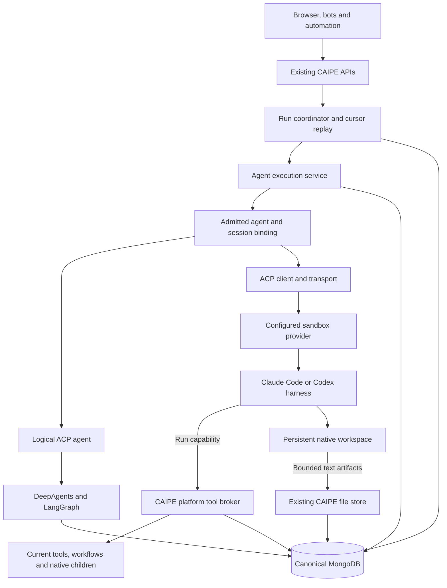
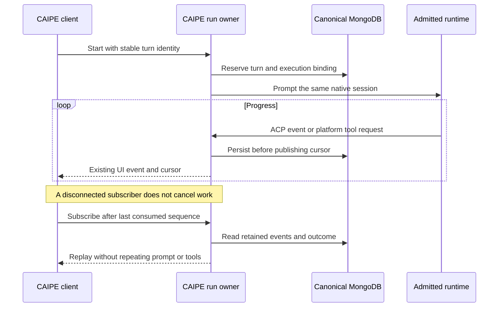

# ACP metaharness

CAIPE owns agent definitions, execution admission, conversation history and the
workflow engine. ACP connects that platform to the runtime executing an agent.
A logical DeepAgents agent and a sandboxed CLI harness use the same CAIPE chat,
run journal and human-input lifecycle; their native state remains different.

The initial phase of the [metaharness proposal](https://github.com/orgs/caipe-io/discussions/2877)
established the native ACP path and detached execution. The current changes add
sandbox profiles, remote ACP transport and a platform tool/workspace bridge.
**These additions are under review. Remote deployment, provider authentication,
network policy and complete skills qualification remain pending approval.**
This document does not imply that a deployed agent has changed runtimes.

## What changes with runtime placement

| Area | Native foundation | Sandbox integration under review |
|---|---|---|
| Execution | Existing DeepAgents/LangGraph runtime behind a logical ACP agent. Default, SRE and custom agents remain shared logical agents. | A configured Claude Code or Codex ACP process in a provider-managed environment. |
| Agent definition | Native model, prompt, tools and skills use existing configuration. | `execution.kind=sandbox` selects a configured `profile_id`; its deployment owns image, command, model route and credentials. |
| Files | Existing simulated filesystem and checkpoint/GridFS storage. | A real persistent workspace, plus bounded text-artifact exchange with CAIPE's existing file store. |
| Session | Original LangGraph thread and admitted storage coordinates. | Pinned environment identity and native provider session ID, stored in the same CAIPE binding. |
| Platform services | Native tools, human input, subagents and the existing workflow engine. | A run-scoped tool broker reuses those services without giving the harness the caller's bearer. |

A sandbox is an execution choice, not an ACP enablement flag. Existing agents
remain native by default. A saved conversation retains its first execution and
storage binding even when its agent definition later changes placement.

Bedrock AgentCore or another SDK runtime still needs its own qualified adapter.
A shared SDK adapter must preserve CAIPE's simulated filesystem; an SDK working
directory does not supply that contract. This integration does not add OpenShell
or another sandbox implementation, cross-environment discovery, or arbitrary
remote endpoint registration.

## One execution service, two placements

The execution service owns leases, binding resolution, runtime lifetime and
state operations. HTTP routes retain authentication, authorization and request
validation. Selecting a sandbox does not create a second conversation writer,
workflow engine or authorization system.

| Protocol boundary | Behavior |
|---|---|
| CAIPE clients | Existing AG-UI/custom SSE and invoke contracts; stable turn IDs and sequenced reconnect. |
| Native ACP | Released Python SDK `0.12.1`, wire protocol `1`; acknowledged `caipe.io/native-acp` events preserve existing native progress and checkpointed approvals. |
| External ACP | The same pinned SDK and wire protocol, standard initialization, new/load, prompt, updates, permission requests and cancellation. A saved native session must load successfully; failure never falls back to a fresh conversation. |
| Form elicitation | A narrow validated shim covers newer schema form messages missing from the SDK callback surface. It accepts session-bound supported fields/choices and bounded decisions; URL elicitation and unsupported schemas are rejected. It does not enable the unstable protocol. |
| Transport | One bounded JSON-RPC object per non-TTY WebSocket message. Stderr and lifecycle controls are separate from ACP. Redirects cannot forward the caller's bearer to another destination. |

Typed events remain the internal boundary. The ACP client renders progress
through existing encoders, including separate reasoning, tools, warnings and
human-input events. It does not infer execution state by parsing UI text.
Native client filesystem/terminal capabilities remain unadvertised; CLI
harnesses operate their own sandbox filesystem and native tools.

The [Harness Engine discussion](https://github.com/orgs/caipe-io/discussions/2405)
and [gateway implementation](https://github.com/caipe-io/ai-platform-engineering/pull/2401)
provide related session, configuration UI and detached-run foundations. This
implementation keeps those concerns behind one CAIPE execution service and ACP
boundary. Provider-specific state is bound to canonical sessions rather than
introducing another routing engine or conversation database.

## Sessions and persistence

| State | Authority and location |
|---|---|
| Conversation and visible history | Existing CAIPE conversation/BFF APIs in canonical MongoDB. The browser remains the interactive transcript writer. |
| Effective configuration and placement | `native_acp_sessions`: original agent/session identity, configuration snapshot and immutable checkpoint/filesystem or sandbox binding. |
| Native runtime state | Existing LangGraph checkpoint collections and logical file namespace. ACP does not rename the original thread. |
| External runtime state | Provider-native session ID and pinned environment identity in the CAIPE binding; CLI transcripts/workspace on the provider's persistent volume. |
| Active execution | `native_acp_runs` owns the native lease; `native_acp_execution_runs` owns turn identity, producer association, outcome and pending human decisions. |
| Replay | `native_acp_execution_events` stores sequenced output; subscribers do not own or restart execution. |
| Platform tool calls | `native_acp_tool_requests` stores bounded, idempotent requests and results under the owning run/lease. Only the producer holding that lease executes them. |

One canonical CAIPE database does not mean one physical store for every byte
of runtime state. A sandbox harness can keep native transcripts, metadata or a
local database on its persistent volume. That may duplicate conversation/tool
content; it is managed runtime state, not another authority for CAIPE identity,
permissions or visible history. ACP does not redirect that storage into MongoDB.

| Operational concern | Consequence |
|---|---|
| Restore MongoDB alone | CAIPE history can be readable while the bound native session cannot resume. Restore and validate the matching workspace/native state too. |
| Delete a conversation | Cleanup must also govern native transcripts, retained volumes and backup expiry. A successful environment-resource deletion is not proof of physical erasure. |
| Change or upgrade a harness | Preserve canonical history, but qualify native-state compatibility or start a new native session explicitly. |
| Require one physical datastore | This implementation does not meet that stronger requirement. A qualified runtime storage adapter or checkpoint export/restore contract would be additional work. |

Admission acquires the native lease before reading or changing runtime state.
The 120-second lease is extended with one-second heartbeat/cancellation polling;
workers require synchronized clocks. New turns refresh permitted configuration
while retaining admitted storage and placement. Human-input resume uses its
saved configuration narrowed by current grants.

A sandbox binding additionally pins the original caller, configured connection,
profile revision, namespace, environment UID, cwd and provider session ID.
Changing a profile/image/policy, losing an environment, or failing session load
requires explicit migration or a new conversation. Existing native checkpoints
are not imported into a different harness as if they were that harness's state.

Worker loss retains persisted output and native state but reports interruption.
Neither the lease nor the journal provides exactly-once effects at an external
service. A claimed platform tool request is not reclaimed after uncertain
failure. Recovery must never repeat a prompt or mutation merely to reconstruct
its response.

## Platform tools, children and human input

The sandbox receives a random run capability for one configured CAIPE MCP
endpoint. Caller bearers and connected-provider credentials remain in the
producer's server-side tool closures. Any API replica may authenticate the
capability and queue a call; only the admitted producer executes it.

- Tool discovery reuses native resource preparation. Each call rechecks current
  agent use, tool configuration and resource admission; a configuration change
  can narrow a running session rather than redirect its pinned workspace.
- Native built-ins, selected MCP/remote tools, workflow tools and configured
  skills retain their existing service owners. The workflow engine is unchanged.
- A configured native child receives its own canonical execution context and
  lease. Delegation rechecks the reference, agent use and evidence boundary,
  including after human pauses; a child cannot reuse its parent's run capability
  or introduce a second sandbox through an unqualified nested execution path.
- Native child/tool approvals, ACP permission requests and supported forms use
  the existing CAIPE UI. The durable pending request validates the actual
  displayed options/schema; model-authored values cannot become human approval.
- Reply submission is idempotent and resumes the waiting producer. It does not
  launch another prompt. Explicit cancellation resolves pending callbacks and
  stops the admitted execution; closing a browser or tool HTTP observer does not.

ACP capability negotiation is not an authorization grant. Existing CAIPE caller,
conversation, workflow and tool authorization still applies. Restricted evidence
and storage aliases must pass execution/workspace admission before they can
cross into an external runtime.

## Workspace and filesystem policy

Native DeepAgents keeps its simulated filesystem. Real CLI execution requires
a separate environment with persistent storage and enforced filesystem/network
policy. ACP itself supplies neither isolation nor egress enforcement.

| Workspace operation | Contract and limit |
|---|---|
| Prepare instructions/skills | One managed snapshot containing `AGENTS.md`, `CLAUDE.md`, `.agents/skills/<id>/...` or `.claude/skills/<id>/...`; the profile selects the harness. |
| Seed workflow files | Permission-checked canonical text files become `inputs/<safe relative path>` in the same prepare call. Shared workflow namespaces require the current canonical run/step/owner; arbitrary namespace overrides are rejected. |
| Prepare bounds | At most 128 files, 1 MiB total and 256 KiB per file. The persistent workspace lock prevents preparation during an active ACP process; stale managed files are removed. |
| Read/list | Bounded regular UTF-8 files, excluding private metadata, credentials, symlinks, hardlinks and special files. Provider listing is bounded at 1,000 results/4,096 visited entries; content at 512 KiB. |
| Publish artifacts | Copy bounded text artifacts into the existing canonical file namespace; do not publish instructions, skills, inputs, credentials or native provider state. Export limits/warnings are explicit rather than claiming all files were copied. |
| Edit/upload/format | A fixed-cwd atomic ordinary-file writer accepts at most 256 KiB. Existing `format_file` imports its requested workspace input and mirrors newly formatted results back. No arbitrary HOME, credential or instruction-metadata writes are exposed. |

The bridge bounds canonical input snapshots and output export independently of
the provider limits. Missing, unsupported or oversized artifacts return an error
or visible warning. They are not silently represented as complete exports.
Reads and ordinary-file writes can operate during ACP execution; instruction
preparation remains exclusive.

The provider must validate CAIPE bearer admission independently, pin configured
image/command/policy revisions, isolate users and session workspaces, and check
actual environment/Pod identity plus administrative controls. Agent definitions
cannot supply executable commands, credentials, images or control-plane URLs.
Admitted long-running execution must not depend on a browser cookie or end
solely because its handshake bearer expires. Reconnect requires fresh admission;
operator execution deadlines and revocation controls still apply.

Model credentials are deployment-owned references, never returned through the
provisioning API. A real CLI may receive its scoped model credential; that is not
out-of-process credential isolation. Use a scoped model gateway and budgets.
Process-group supervision cleans up ordinary descendants, but deliberately
separated process groups require a stronger per-run cgroup/container boundary.
Filesystem, egress, model routing and lifecycle guarantees need qualification in
the selected provider, not just protocol tests.

## Conversation management

| Operation | Native runtime | Sandbox runtime |
|---|---|---|
| Reconnect/reload | Replay the existing journal and continue checkpointed state. | Replay the same journal; subsequent turns load the pinned provider session. |
| Stop | Cancel the owning native turn and wait for cleanup. | Cancel the actual admitted ACP prompt and its producer/tool/input work; retain saved context. |
| Clear | Retire obsolete journals and remove admitted checkpoint/files. | Delete the exact pinned environment before resetting its provider reference and canonical files. Cleanup failure remains visible and retryable. |
| Permanent deletion | Fence late admissions, clear native state, then remove canonical history through existing authorization. | Apply the same fence, perform owner-bound generation/version-checked remote cleanup, then finish canonical deletion. Retained volumes/backups follow deployment policy. |
| Rewind | Existing checkpoint rewind. | Explicitly unsupported; start a new conversation to branch from earlier history. No transcript-only pretend rewind. |
| Restart runtime | Rebuild the cached native runtime with current resources. | Explicitly unavailable for a retained provider session; use the supported clear/new-conversation lifecycle. |

A minimal deleted-session ledger prevents late requests from recreating a
permanently removed context. Soft deletion keeps archive/restore behavior.
Clear/deletion does not prove physical erasure of retained provider volumes,
snapshots or backups.

## Operator configuration and qualification

Configure these settings on Dynamic Agents; no Compose default or existing
agent is switched by supplying them:

| Setting | Purpose | Default |
|---|---|---|
| `SANDBOX_SERVICE_URL` | Operator-owned control-plane base URL, optionally including its installed base path. The client appends the fixed `/api/caipe` contract. | Empty; sandbox placement unavailable. |
| `HARNESS_TOOLS_PUBLIC_URL` | CAIPE MCP broker base reachable from the sandbox, normally `https://caipe.example.test/api/v1/harness-tools`; the run adds `/{run_id}/mcp`. | Empty. |
| `HARNESS_TOOLS_ALLOW_HTTP` | Explicit private/local exception for plaintext broker transport; HTTPS is the normal contract. | `false` |
| `SANDBOX_PROVISION_TIMEOUT_SECONDS` | Bounded readiness wait; expiry preserves the idempotent environment for retry. | `600`, range 10–1800. |

The provider contract supplies configured profile discovery, idempotent creation,
identity/status, resume/suspend/delete, scoped workspace operations and a
non-TTY ACP relay. It needs independently configured CAIPE issuer/audience/JWKS,
access policy, pinned harness profiles, storage, model Secret references and
routes back to CAIPE. Unattended sandbox workflows/triggers also need a qualified
delegated caller identity; a service-account token plus an email header cannot
stand in for human authorization. Native automation is unchanged. Its API may
expose no arbitrary exec or caller-selected
credential destination. Refer to the [component configuration](https://github.com/caipe-io/ai-platform-engineering/tree/main/ai_platform_engineering/dynamic_agents#sandbox-runtime-configuration)
for the exact request fields and limits.

| Verification | What it establishes |
|---|---|
| Deterministic ACP/MongoDB tests | Serialized events, immutable binding, reconnect, human decisions, capability isolation, child admission, file boundaries and cleanup behavior in source. |
| Offline adapter boot | Negotiation and advertised native session capabilities without model/provider calls. It does not establish credential or model compatibility. |
| Deployment qualification pending approval | Actual provider login, model gateway, MCP reachability, skills execution, policy enforcement, session restore after process/Pod loss, cancellation and retained-volume lifecycle. |

Use the same `MONGODB_URI`/`MONGODB_DATABASE` for canonical CAIPE records and
include ACP bindings, leases, executions/events, tool requests, checkpoints and
GridFS in backups. Back up provider-native session/workspace volumes separately;
restoring MongoDB alone does not restore a remote CLI session. Restored leases
must expire, not restart work. Journal limits remain 8 MiB/frame, 64 MiB/run and
100,000 frames/run, with explicit failure instead of successful truncation.

Rollback restores prior image pins through the normal deployment process and
preserves state. It cannot convert an admitted CLI session into a native
checkpoint; retain the compatible runtime or perform an explicit migration.
