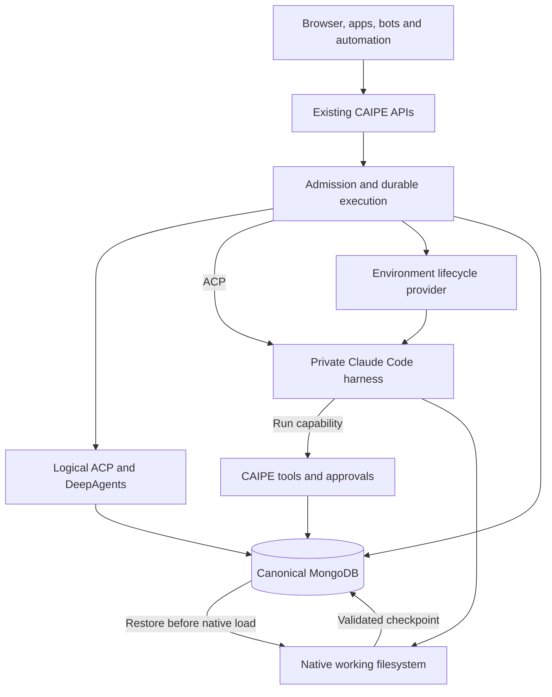
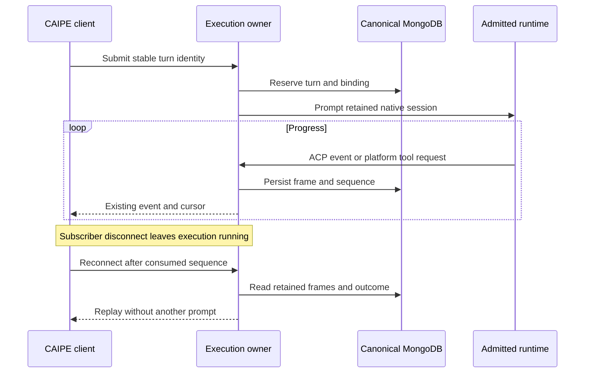
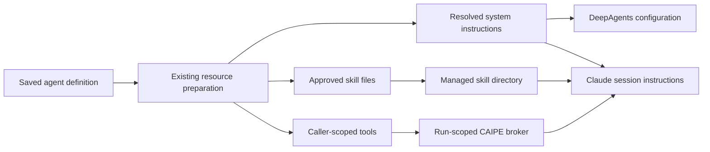

# ACP metaharness

CAIPE owns agent definitions, execution admission, canonical conversations and the existing workflow engine. Agent Client Protocol (ACP) connects that platform to the harness that runs the reasoning and tool loop. Managed DeepAgents and private Claude Code sandboxes share the same editor, chat, run journal and human-input lifecycle; their executable state remains specific to each runtime.

The [native ACP foundation #2883](https://github.com/caipe-io/ai-platform-engineering/pull/2883) supplies the common native path and detached execution. The [sandbox extension #2982](https://github.com/caipe-io/ai-platform-engineering/pull/2982) supplies the Claude Code placement, platform bridge and native-state checkpoints. Both are under review. The source implementation and its tests do not establish that a deployed provider's authentication, model route, filesystem/network policy or skills have been qualified. The [metaharness proposal](https://github.com/orgs/caipe-io/discussions/2877) covers the wider design.

## Supported execution models

| Model | Definition and user experience | Workspace and state |
| --- | --- | --- |
| **Managed Agent** | Existing default/custom DeepAgents agent; `execution.kind=native` remains the default. The saved prompt, model, tools, skills and current native features are retained. | Shared service with admitted logical files and LangGraph checkpoints. Interactive storage defaults to the conversation; existing authorized namespace and workflow-artifact scopes remain intact. Logical files do not provide OS containment. |
| **Private Coding Sandbox** | Opt-in Claude Code profile; `execution.kind=sandbox` and an operator-owned `profile_id`. Provisioning is automatic through the same editor and chat. | One whole private environment and native session per caller-owned conversation. HOME, writable workspace and credentials are not shared across callers or conversations. Committed native state lives in canonical MongoDB/GridFS. |

Existing agents and conversations keep their runtime binding. A shared agent definition does not create an agent per user, merge their conversations or grant access to another caller's workspace. New coding-runtime support uses the ACP harness boundary; CAIPE does not add another SDK reasoning engine. A harness may internally use its own SDK.

| Identity | Authority |
| --- | --- |
| Agent definition | Shared, versioned instructions, selected resources and admitted runtime profile. |
| Caller | Independently authenticated principal with current agent/resource permissions. Scheduled owner runs and admitted service accounts retain their verified identities. |
| Conversation and run | Canonical history, native session, pending decisions, stable turn identity and execution lease. |
| Workspace | Admitted logical namespace or private conversation environment, with a lifecycle separate from transcript visibility. |

Viewing shared history does not grant shell access, transfer a native session or authorize continuation as its owner. The private model isolates the whole environment; user subdirectories in a shared HOME are not an equivalent boundary. Images and immutable tools can be shared without sharing writable state.

### Alternatives not adopted

| Alternative | Decision and reason |
| --- | --- |
| Shared team SDK sandbox | Excluded from this implementation. A shared directory is an intentional data-sharing boundary, and one conversation's whole-environment restore could overwrite another's work. It does not satisfy the private owner-bound checkpoint contract. |
| Coding harness with simulated files only | Excluded from this implementation. Optional ACP file/terminal callbacks cannot virtualize a CLI's built-in tools. Restricting all native shell/file tools would change the coding feature set; Claude's `allowed_tools` setting is auto-approval, not a tool-removal boundary. |

These alternatives are absent from the executable runtime catalog. DeepAgents already provides the retained logical-filesystem model; Claude Code uses a real isolated environment.

## One execution service

HTTP routes retain authentication, authorization and request validation. The execution service owns admission, session bindings, leases, runtime lifetime and state operations. The environment provider owns process isolation, working storage and enforced network policy. Selecting a sandbox adds no second conversation writer, workflow engine or authorization system.

The service-owned pump and cursor journal adapt the [Harness Gateway work](https://github.com/caipe-io/ai-platform-engineering/pull/2401), discussed in [Harness Engine #2405](https://github.com/orgs/caipe-io/discussions/2405), behind the existing execution authority. ACP supplies the interaction boundary; the retained native lease and canonical database remain authoritative.

| Boundary | Implemented contract |
| --- | --- |
| Clients to CAIPE | Existing AG-UI/custom SSE and invoke contracts, stable turn IDs and sequenced replay. |
| Logical native ACP | Released Python SDK `0.12.1`, stable wire protocol `1`; acknowledged `caipe.io/native-acp` events retain native progress and checkpointed approvals. No direct-dispatch fallback. |
| Coding-harness ACP | Standard initialization, new/load, prompt, progress, permissions and cancellation. A saved session must load successfully; failure cannot silently create a replacement or fall back to DeepAgents. |
| Remote transport | One bounded JSON-RPC object per authenticated, non-TTY WebSocket message. Stderr and lifecycle controls remain separate. Redirects cannot forward the caller's bearer elsewhere. This is a configured relay, not a claim of standard remote-HTTP ACP. |
| Form elicitation | A narrow validated shim supplies newer form messages missing from the pinned SDK callback surface. It accepts supported session-bound fields, choices and bounded decisions; URL elicitation and unsupported schemas fail explicitly. |

The [released ACP schema 1.26.0](https://github.com/agentclientprotocol/agent-client-protocol/releases/tag/schema-v1.26.0) is the feature-coverage reference. Stable v1 and unstable methods remain distinct; SDK major versions do not select the wire version. Typed semantic events feed the existing UI encoders, including separate reasoning, tools, warnings and human input. The bridge does not recover runtime meaning by parsing UI text. Native client filesystem/terminal callbacks remain unadvertised; the coding harness uses its own sandbox tools.

## Sessions, runs and canonical storage

| State | Location and owner |
| --- | --- |
| Login and browser state | Existing OIDC/NextAuth authentication and browser view/stream state. Neither is executable agent state. |
| Conversation and visible history | Existing CAIPE conversation/BFF APIs in canonical MongoDB; the browser retains its interactive message-writer role. |
| Admitted configuration and placement | `native_acp_sessions`: original agent/session identity, effective configuration and admitted checkpoint/filesystem or sandbox binding. |
| Managed runtime state | Existing LangGraph checkpoints and logical file namespace, with the original thread ID. |
| Coding runtime state | Versioned HOME/workspace archives in canonical GridFS; manifests in `native_acp_checkpoints`. Provider storage is the working copy. |
| Lease and checkpoint head | `native_acp_runs`: execution lease, checkpoint publication fence and recovery intent. |
| Durable turn and decisions | `native_acp_execution_runs`: stable turn identity, producer association, outcome and pending human decisions. |
| Output replay | `native_acp_execution_events`: exact sequenced frames, independent of subscribers. |
| Platform tool calls | `native_acp_tool_requests`: bounded idempotent requests/results under the owning run and lease. |

Normal interactive conversation IDs remain the native session/checkpoint thread IDs. Existing workflow execution-context mapping is retained; a grouped automated history is not a shared physical workspace or executable checkpoint.

### Durable execution and browser recovery

- The UI persists the user turn and assistant placeholder before submission. Reload reconstructs the unfinished response through the existing message writer; replay is never sent back as a new prompt.
- Repeating the same prompt or human-input submission attaches to its original turn. Changed validated input conflicts. An EOF without a durable outcome is not success.
- Stop targets the submitted turn, including delayed admission, and drains runtime cleanup before the terminal outcome. Observer disconnect is not cancellation.
- A lost worker retains output and the last committed native state, then reports interruption. The journal does not restart prompts, tools or approval callbacks, and cannot guarantee exactly-once external effects.
- Replay is bounded to 8 MiB per frame, 64 MiB and 100,000 frames per run. Gaps and overflow fail explicitly. No automatic event expiry is introduced.

The existing 120-second native lease is extended with one-second heartbeat/cancellation polling; workers require synchronized clocks. Admission acquires that lease before state access. New turns refresh permitted configuration while retaining admitted placement/storage. Human-input resume uses its saved configuration narrowed by current grants.

A sandbox binding also pins the original caller, configured connection, profile revision, namespace, environment UID, cwd and native session ID. A changed profile, image, policy or incompatible runtime needs explicit migration or a new conversation. A transcript is not a portable checkpoint, and DeepAgents state is not imported as Claude state.

### Native checkpoints for coding harnesses

Claude Code keeps its native file layout while running. Quiescent archives preserve native transcripts, child state, compaction, file history, settings, workspace files and local database/WAL files without translating them into CAIPE messages or replacing native file checkpointing with an experimental external session-store API.

| Boundary | Guarantee |
| --- | --- |
| Settled successful turn | Close/drain ACP, validate the complete archive and persisted hash, then publish its head under the current live lease before success. A capture/storage failure cannot become a completed turn. |
| Subsequent load | Restore the committed head before `session/load`, even on a healthy volume. Each hydration has a new restore identity; uncommitted working files cannot replace canonical state. |
| Lost environment | Recover only from a committed checkpoint with the same owner, profile/native versions and session ID. Persist recovery intent, verify the exact restore receipt and fence the replacement binding before execution. |
| Stop or graceful failure | Attempt bounded quiescent capture while the worker owns its lease. Failure retains the previous committed head and remains visible. |
| Before the first checkpoint | The journal is durable, but total working-storage loss can lose the unfinished first native state. A fresh state is not fabricated from displayed history. |
| Hard loss during an external effect | Report interruption. The last checkpoint does not establish whether an external mutation completed. |

Uploads remain unpublished until fully validated. The checkpoint head shares the existing lease document, preventing stale workers from publishing over a new owner. An unfinished restore blocks execution.

Archives retain the managed-file manifest so revoked skills and inputs can be removed. Fixed exclusions omit operational scratch/locks and known native login files; deployment credentials are supplied again. Tool-produced secrets can still enter workspace/native archives, so their access, encryption and backup controls match other sensitive CAIPE state.

The archive contract bounds both archive and expanded state to 256 MiB, each file to 128 MiB and entries to 20,000. Capacity includes the whole working HOME and repository/native history. Active snapshots retain three recent recovery versions plus restore provenance; retained edit boundaries pin additional native state for conversation history. Clear/delete removes live records/blobs, and bounded cleanup retires interrupted uploads. Backup expiry remains an operator policy.

## Prompts, skills and platform tools

The saved system-prompt field remains the editor and source of instructions. Resource preparation resolves the admitted configuration without asking a model to translate it. Claude receives the resolved `systemPrompt`, managed `CLAUDE.md`/`AGENTS.md` and selected `.claude/skills` files. Managed-file reconciliation removes revoked skills; existing refresh/resume rules and immutable placement still apply.

The sandbox receives a random run capability for one configured CAIPE MCP endpoint. Caller bearers and downstream connected-provider tokens stay in trusted producer-side tool closures. Any API replica may validate and queue the request; only the lease-owning producer executes it.

| Integration | Behavior and limit |
| --- | --- |
| Tools, knowledge and workflows | Existing resource preparation, built-ins, selected MCP/remote tools and workflow services remain authoritative. Each call rechecks current agent use, configuration and resource admission. |
| Native children | Configured native children have their own execution context, admission and lease. References and evidence boundaries are rechecked, including after pauses. A child cannot borrow its parent's capability. |
| Human input | Native approvals, ACP permissions and supported forms use persisted exact options/schema. Model-authored values do not become human decisions. Replies are idempotent and resume the waiting producer. |
| Model retries | The pinned SDK retries within one ACP prompt; CAIPE never resends the whole prompt to imitate inference retries. Differing middleware semantics are reported. |
| Model budget | The native `maxTurns` budget maps the configured per-run limit. Exhaustion is not success. Thread-wide middleware limits are explicitly rejected. |
| Platform retries and budgets | Existing retry middleware applies only to server-declared read-only/idempotent tools; each attempt rechecks grants/configuration/lease. Counts live in the durable run record. Uncertain mutations are not automatically repeated. |

Native parents delegating to sandbox children and Codex admission are excluded. Native shell/file tools remain governed by the admitted runtime/environment policy. Instructions and repository skills do not widen filesystem, network, credential or tool authority.

## Workspace and policy boundaries

DeepAgents retains its logical filesystem. The private coding runtime requires an isolated real filesystem and enforced network policy. ACP permissions and capability flags supply neither OS containment nor egress enforcement; disabling client callbacks does not disable a harness's built-in shell/file tools.

| Workspace operation | Implemented boundary |
| --- | --- |
| Prepare instructions, skills and inputs | One managed snapshot; at most 128 files, 1 MiB total and 256 KiB/file. Preparation is locked against active execution and removes stale managed files. |
| Copy canonical inputs | Permission-checked text/binary inputs become `inputs/<safe relative path>`. The CAIPE bridge allows 64 files, 512 KiB total and 256 KiB/file. Required workflow inputs fail if over budget; interactive omissions produce visible warnings. |
| Read and export | Ordinary regular files only; private metadata, credentials, symlinks, hardlinks and special files are excluded. Provider listing is bounded to 1,000 results/4,096 visited entries. CAIPE content reads allow 512 KiB/file and output export totals 4 MiB. |
| Edit, upload and format | Ordinary fixed-cwd atomic writes are bounded to 256 KiB. `format_file` remains text-only and mirrors its formatted result back into the real workspace. Instruction/native-state paths are not exposed as ordinary writable artifacts. |
| Binary exchange | Strict base64, decoded byte counts and SHA-256 receipts. Existing canonical GridFS records use `encoding=base64`; downloads preserve original bytes. Text previews remain text-only. |

Artifact reads/writes can operate during ACP; managed preparation is exclusive. Artifact publication excludes instructions, skills, inputs, credentials and private native state. Omitted/oversized files are not represented as complete exports.

Effective access is the intersection of caller/resource grants, saved agent selections, the admitted runtime/environment profile and narrower workflow/run constraints. Browser, CLI, app, bot and webhook entry points normalize independently verified identity and enter the same admission path. Channel names and email headers do not grant a human's identity or resources. Existing CAIPE/CAS authorization remains authoritative; no ACP-specific policy database is added.

| Authority | Responsibility |
| --- | --- |
| CAIPE | Caller, agent, conversation and resource admission; approvals; tool budgets; leases and current grants. A user approval cannot override a denied profile/resource boundary. |
| Operator profile | Pinned harness/image/policy revision, model route, limits and workspace scope. Definitions contain no caller-selected commands, images, URLs or secrets. Catalog metadata describes this contract rather than attesting to live enforcement. |
| Environment provider | Independent CAIPE issuer/audience/JWKS validation, owner/generation checks, process identity and OS filesystem/network enforcement. Denied mounts, metadata/control-plane access and unapproved destinations remain blocked below the model. |

A run-bound capture grant keeps bounded workspace exchange and native-state export available after the handshake bearer expires, up to the admitted deadline plus capture grace. The provider stores only its hash and rechecks identity, policy and expiry. The grant cannot provision, restore, start ACP or operate lifecycle controls, and is revoked after capture. Neither it nor the caller's bearer reaches the agent. Reconnect reauthenticates; operator deadlines and revocation still apply.

The harness may receive a scoped deployment-owned model credential. Process groups, session labels and per-user paths are not a boundary against hostile same-UID code; containment belongs to the provider. [ACP files](https://agentclientprotocol.com/protocol/v1/file-system), [terminals](https://agentclientprotocol.com/protocol/v1/terminals) and [DeepAgents storage backends](https://docs.langchain.com/oss/python/deepagents/backends) describe interaction/storage interfaces, not OS enforcement.

## Provider ownership and reuse

CAIPE uses a thin integration with the configured environment provider. The provider owns allocation, worker pools, isolation, network enforcement and snapshots; CAIPE owns its canonical definition, policy admission and state binding. There is no new complete CAIPE Pod/VM controller or second independently editable agent definition. A Kubernetes projection can reference admitted CAIPE/profile identity without containing user tokens, history or duplicate prompts.

| Comparison, as of 20 October 2026 | Decision |
| --- | --- |
| [Kagent 0.10.3](https://github.com/kagent-dev/kagent/releases/tag/v0.10.3) | Its OpenClaw/Hermes harness path uses ACP internally, but a shared Actor does not provide private writable-state isolation per caller. It is not the selected Claude provider contract. |
| [Kagent 1.0.0-alpha16](https://github.com/kagent-dev/kagent/releases/tag/v1.0.0-alpha16) | Claude/Codex/BYO and per-session Actors provide useful infrastructure, but the API/runtime line is alpha. Its complete session service owns PostgreSQL/task state and Substrate snapshots, so adopting that stack would introduce a separate state authority. It is not adopted here. |
| [SIGs Agent Sandbox 1.0.7](https://github.com/kubernetes-sigs/agent-sandbox/releases/tag/v1.0.7) | Lifecycle, templates, claims and warm pools are infrastructure rather than a replacement CAIPE history service. It is not an implemented provider in this change. |

The selected boundary reuses the existing provider through the narrow lifecycle/state contract. Provider internals are interchangeable only when their identity, ACP, policy and verified native export/restore behavior match that contract. Internal ACP use alone establishes none of those guarantees. The [kagent persistence contract](https://github.com/kagent-dev/kagent/blob/v1.0.0-alpha16/docs/architecture/persistence-checkpoints-and-forks.md) explains why wholesale session-service adoption differs from environment reuse.

## Conversation operations and recovery

| Operation | Managed runtime | Private coding sandbox |
| --- | --- | --- |
| Reconnect/reload | Replay retained output and continue checkpointed state. | Same journal; restore committed native state before the next native load. |
| Stop | Cancel the owning turn and wait for cleanup. | Cancel the actual ACP prompt and its producer/tool/input work; retain committed context. |
| Clear | Retire obsolete replay and admitted checkpoints/files. | Delete the exact pinned environment, purge owned checkpoints, then reset its provider reference/files. Failures remain visible and retryable. |
| Permanent deletion | Fence late admission, clear state and remove canonical history through existing authorization. | Same fence plus owner-bound generation/version-checked remote cleanup. |
| Rewind | Existing checkpoint rewind. | Restore the selected turn's pre-prompt native state and linked native-child checkpoints. A durable edit intent gates later prompts until UI history is reconciled. First-turn edit creates genuinely fresh native state; a missing retained boundary fails explicitly. |
| Restart runtime | Rebuild cached runtime/resources. | Reconnect ACP/MCP and reload the same native session/workspace; no deletion or repeated prompt. |

The minimal deletion ledger prevents late requests recreating a permanently removed context. Soft deletion retains archive/restore behavior. Clear/delete does not prove physical erasure of retained provider volumes or backups.

All canonical services use the same `MONGODB_URI`/`MONGODB_DATABASE`. A consistent backup includes conversation history, bindings, leases, execution/events, tool requests, checkpoint manifests and complete GridFS buckets. A restore recovers committed native state; leases expire rather than restart work. A database backup cannot preserve a live process or determine an in-flight external mutation's outcome. Provider volume copies are optional additional recovery copies.

Rollback changes reviewed deployment image pins while preserving compatible state. It cannot convert a coding session into a DeepAgents checkpoint. A compatible pinned runtime or an explicit migration is required.

## Configuration and verification boundary

The [component README](https://github.com/caipe-io/ai-platform-engineering/tree/main/ai_platform_engineering/dynamic_agents#sandbox-runtime-configuration) owns environment variables, provider request fields, artifact bounds and local test commands. An empty `SANDBOX_SERVICE_URL` leaves sandbox placement unavailable; configuring it does not switch saved definitions or deploy an environment.

| Verification | What it establishes |
| --- | --- |
| ACP and real-MongoDB source tests | Serialization, bindings, leases, replay, human decisions, child admission, artifact boundaries, rewind/restart and cleanup behavior. |
| Pinned native resume | A genuine Claude ACP session, production archive export, working-state deletion, verified restore and fresh-process load of the same native session/context using loopback inference. |
| Canonical backup recovery | MongoDB dump/drop/restore recovers archive, binding, head and journal; a fresh Claude process loads the recovered native state. |
| Deployment acceptance | Actual provider authentication, model/tool/skills compatibility, enforced filesystem/network policy, process/Pod-loss recovery, cancellation and retained-volume lifecycle. Source/prebuild tests alone do not establish these deployment properties. |
