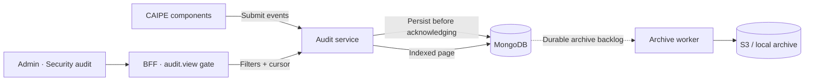

# Querying security audit history

The audit service uses MongoDB for interactive reads and local disk or S3 for archival.
Authorization policy and audit delivery are separate: an unavailable audit store does not change CAS's allow/deny result.

- One **Security audit** view replaces the overlapping Access decisions/RBAC views. It starts with CAS decisions; policy changes, authentication and other event types remain available through filters.
- Each request returns one bounded page. The BFF no longer downloads earlier pages or scans S3 for every click.
- Next/Previous retain the query's time range and ingestion cutoff. Refresh starts a new query. ZIP export follows the same cursor contract.
- A `48h` filter is a viewing window, not retention. Query retention defaults to no expiry; archive retention remains separately configured.
- An empty result is not proof that an operation never happened. Producer delivery remains best-effort; read outages are shown explicitly.
- Component provenance and signed caller context are **not** added by this change.
- MongoDB capacity is a rollout trade-off, not a free performance guarantee. Producers remain buffered, but sharing the app's MongoDB still shares database resources; high-volume deployments can use a separate instance. Validate load before production.

## Upgrade requirement

Deploy the audit service and BFF/UI together. The offset/page/total API is intentionally replaced, not maintained alongside the new one.

Existing history needs a one-off, idempotent archive-to-Mongo backfill. The script defaults to dry-run and never changes source archives. Drain the old collector before cutover and verify the final overlapping migration before resuming traffic. No CAS grant or identity migration is involved.

See the [audit-service README](https://github.com/caipe-io/ai-platform-engineering/blob/main/ai_platform_engineering/audit_service/README.md) for API fields, MongoDB/Helm settings, migration commands, recovery behavior and rollback.
